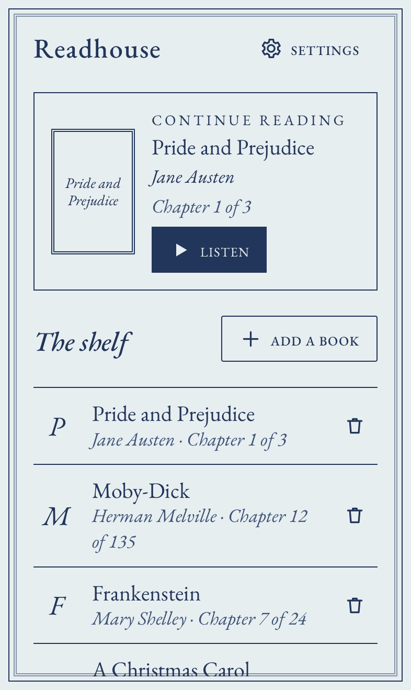
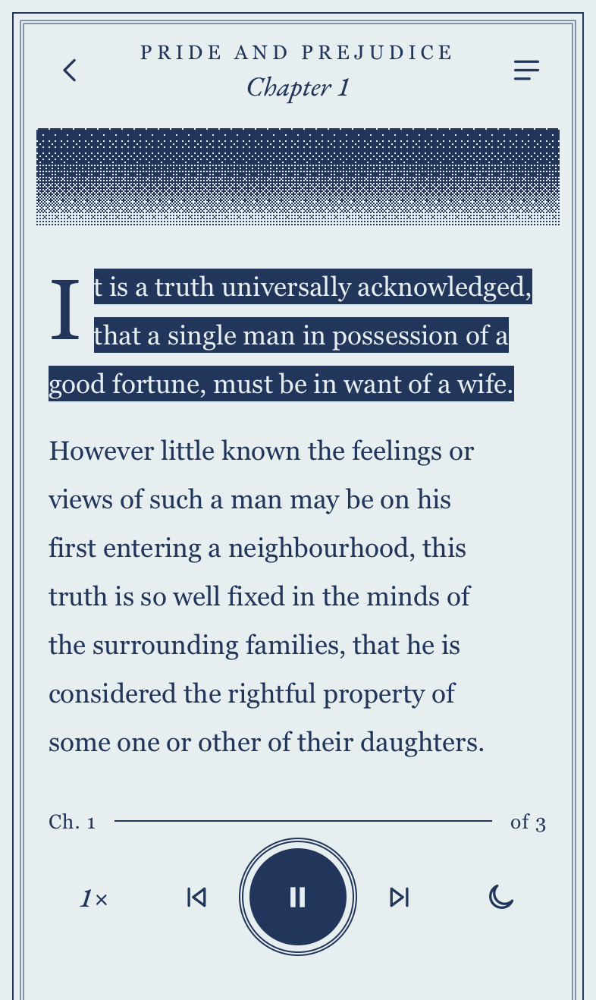
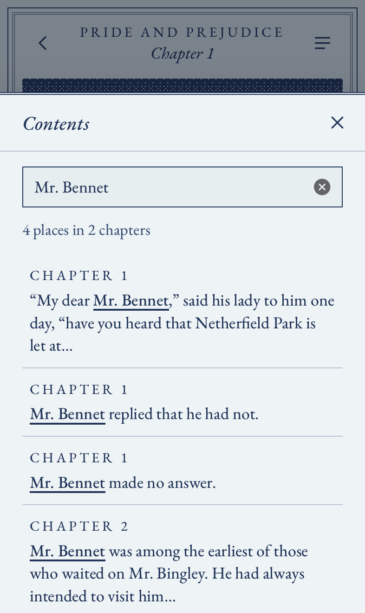
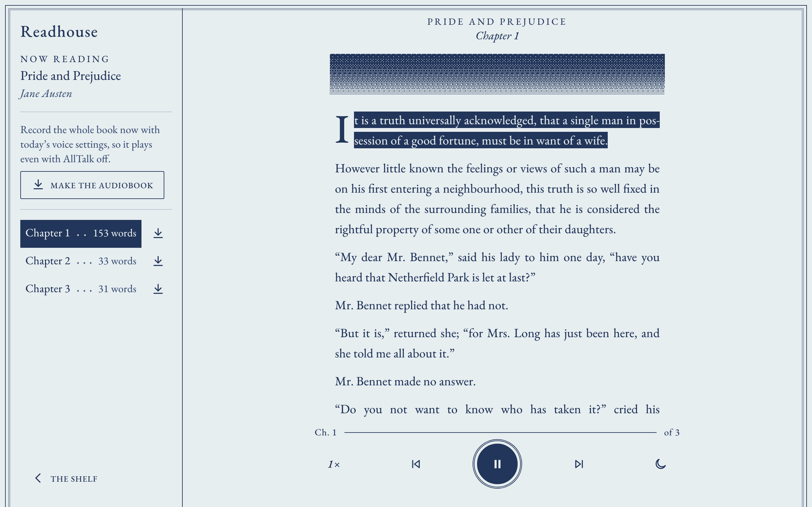

# Readhouse

**Your books, read aloud.** Readhouse turns EPUBs, text files and AO3 chapters into a quiet
reading room that reads to you, in voices you choose, with [AllTalk](https://github.com/erew123/alltalk_tts/tree/alltalkbeta)
doing the speaking. It runs on your computer and you listen on your phone.

A Motherhouse app, alongside Ditherhouse.

<p>
  
  
  
</p>

▶ **[Watch a 40-second walk-through](docs/media/readhouse-phone.mp4)** (phone, no sound).

<p>
  
</p>

- **Bring any book.** EPUB (including AO3 downloads), plain text (Project Gutenberg files are
  cleaned up automatically), or paste a chapter straight from an AO3 page. New books open where
  the story starts, past the praise and copyright pages.
- **Chapters, not walls of text.** Readhouse finds the chapters and gives you a table of
  contents; it remembers where you stopped in every book, on every device.
- **Listen and read along.** The sentence being read is highlighted and followed on screen. Tap
  any paragraph to start from there. Speed, sleep timer, lock-screen controls.
- **Find a passage.** Search the whole book from Contents and pick up from any place you find.
- **Your voices.** Pick AllTalk's model and voice in Settings, hear a voice before choosing it,
  and set how long each spoken passage is.
- **Make the audiobook.** Record a whole book ahead of time; it then plays even with AllTalk
  switched off. Or save single chapters to your phone for listening offline.
- **Easy on the eyes.** Light, dark and sepia themes, text sizes from tiny to extra large, and
  how far into the book you are (or not, if you'd rather not know). Keyboard shortcuts on a
  computer.
- **Private by design.** Everything stays on your machine. Optional passcode for other devices.

## What you need

- A computer that runs [AllTalk v2](https://github.com/erew123/alltalk_tts/tree/alltalkbeta)
  (the `alltalkbeta` branch). XTTS v2 is the recommended engine. A GPU makes it quick; on a CPU
  it works, but each passage takes a few seconds to make, so the first one after Play is slower.
- [mise](https://mise.jdx.dev) (installs the right Node.js and pnpm for you).
- Optional: [ffmpeg](https://ffmpeg.org) on the same computer. Readhouse then compresses audio to
  AAC, about eight times smaller than AllTalk's WAV files, which helps phones on mobile data and
  makes offline chapters small.

## Install and run

```bash
git clone https://github.com/mm0x1/readhouse.git && cd readhouse
mise trust                              # allow this folder's mise.toml
mise install                            # Node.js and pnpm
mise x -- pnpm install --frozen-lockfile
cp .env.example .env                    # then point ALLTALK_URL at AllTalk
mise run build
mise run start                          # http://localhost:3000
```

Start AllTalk first. To update later: `git pull`, then the `pnpm install`, `build` and `start`
lines again; your library in `DATA_DIR` is kept, and the database upgrades itself.

## Connecting to AllTalk

AllTalk is installed and set up on its own (see its documentation). Readhouse needs one value
from it: **`ALLTALK_URL`**, the address of AllTalk's API as seen from the computer running
Readhouse, not from your phone. AllTalk's API uses port 7851 unless you changed it.

| AllTalk runs on…       | Put in `.env`                                     |
| ---------------------- | ------------------------------------------------- |
| the same computer      | nothing (the default is `http://127.0.0.1:7851`)  |
| another computer       | `ALLTALK_URL=http://<that computer's address>:7851` |
| a different port       | `ALLTALK_URL=http://127.0.0.1:<port>`             |

To check it, open **Settings** in Readhouse: it says **Connected**, followed by AllTalk's engine
and model. If it says it can't reach AllTalk, check that AllTalk is running and that the address
and port match. Tested with AllTalk v2 (`alltalkbeta` at commit `f16117e`, 2026-01-09) with the XTTS v2 and
APITTS models.

## Listening on your phone

### Recommended: Tailscale (HTTPS, works anywhere)

With [Tailscale](https://tailscale.com) on the computer and the phone:

```bash
# Only accept connections from this computer; Tailscale brings the phone in.
HOST=127.0.0.1 mise run start
tailscale serve --bg 3000
```

Open the `https://<computer>.<tailnet>.ts.net` address on your phone, then **Add to Home
Screen**. HTTPS unlocks everything: offline chapters, lock-screen controls and the installed app.
Only devices on your tailnet can reach it.

If your proxy sends `X-Forwarded-Proto`, also set `PROTOCOL_HEADER=x-forwarded-proto` so
Readhouse marks its cookies as HTTPS-only.

### On your home network

Run it as above without `HOST=127.0.0.1` and open `http://<computer-ip>:3000` on your phone.
Reading and listening work; browsers only allow offline chapters and some lock-screen features
over HTTPS. If other people share your network, set `ACCESS_PASSCODE`.

## Configuration

All settings live in `.env` (see `.env.example`) and are checked when Readhouse starts.

| Variable             | Default                 | What it does                                                 |
| -------------------- | ----------------------- | ------------------------------------------------------------ |
| `ALLTALK_URL`        | `http://127.0.0.1:7851` | Where AllTalk is, seen from this computer.                   |
| `DATA_DIR`           | `data`                  | Library database and generated audio.                        |
| `ACCESS_PASSCODE`    | none                    | Ask for a passcode on other devices (6+ characters).         |
| `AUDIO_FORMAT`       | `auto`                  | `auto` compresses to AAC if ffmpeg is installed.             |
| `AUDIO_CACHE_MAX_MB` | `2048`                  | Disk space for audio before the least recently played goes. |
| `UPLOAD_MAX_MB`      | `64`                    | Largest book file you can add.                               |
| `HOST` / `PORT`      | `0.0.0.0` / `3000`      | Where Readhouse listens.                                     |

## Keeping it running

macOS (`~/Library/LaunchAgents/com.motherhousehq.readhouse.plist`):

```xml
<?xml version="1.0" encoding="UTF-8"?>
<!DOCTYPE plist PUBLIC "-//Apple//DTD PLIST 1.0//EN" "http://www.apple.com/DTDs/PropertyList-1.0.dtd">
<plist version="1.0">
<dict>
	<key>Label</key><string>com.motherhousehq.readhouse</string>
	<key>WorkingDirectory</key><string>/path/to/readhouse</string>
	<key>ProgramArguments</key>
	<array><string>/opt/homebrew/bin/mise</string><string>run</string><string>start</string></array>
	<key>RunAtLoad</key><true/>
	<key>KeepAlive</key><true/>
</dict>
</plist>
```

Then `launchctl load ~/Library/LaunchAgents/com.motherhousehq.readhouse.plist`.

Linux (systemd user service, `~/.config/systemd/user/readhouse.service`):

```ini
[Unit]
Description=Readhouse

[Service]
WorkingDirectory=/path/to/readhouse
ExecStart=/usr/bin/env mise run start
Restart=on-failure

[Install]
WantedBy=default.target
```

Then `systemctl --user enable --now readhouse`.

**Backups.** Everything lives in `DATA_DIR`: copy `readhouse.db` while Readhouse is stopped. That
alone restores the library and every place in it; audio left out is made again when it's next
played. Copy `audio/` too to skip that, and `secret.key` (with a passcode) so devices stay
unlocked. To restore, put the files back in `DATA_DIR` and start Readhouse.

## Security

Readhouse is meant for you and your devices. It still treats the network as hostile:

- Same-origin only: cross-site requests are refused, and there is no CORS.
- A strict Content Security Policy; book files are reduced to plain text and never rendered as
  HTML; covers are checked by their bytes and served sandboxed.
- Every request is validated against a schema and size-limited; uploads are checked while
  they stream; EPUB archives are unpacked with hard limits (no zip bombs).
- With `ACCESS_PASSCODE`, devices get a signed, HttpOnly, SameSite=Strict cookie for 90 days.
  Wrong guesses are rate-limited. Changing the passcode signs every device out.
- AllTalk is only ever called by the server, at the address you configured; the browser never
  talks to it.

## Development

```bash
mise run setup          # dependencies, test browsers and the pre-push hook
mise run fake-alltalk   # a stand-in AllTalk on :7851, no GPU needed
mise run dev            # dev server with hot reload
mise run check          # the full gate: types, lint, unit, audit, secrets, end-to-end
mise run visual:update  # accept reviewed visual changes (new screenshot baselines)
mise run screenshots    # retake the README screenshots in docs/screenshots
mise run demo           # re-record the walk-through video in docs/media
```

The gate includes screenshot comparisons of every key screen in every theme. They run on your
machine and in the pre-push hook but not in CI, since the baselines are made on macOS and Linux
renders fonts differently.

The plan, decisions and progress live in [`docs/backlog.md`](docs/backlog.md). Agent notes are
in [`CLAUDE.md`](CLAUDE.md). The AllTalk API reference is [`docs/alltalk-api.md`](docs/alltalk-api.md).

Built with SvelteKit, Svelte 5, TypeScript and SQLite (Node's built-in driver).

## License

[MIT](LICENSE). AllTalk is a separate project with its own license; Readhouse talks to it over
HTTP and doesn't include any of its code.
